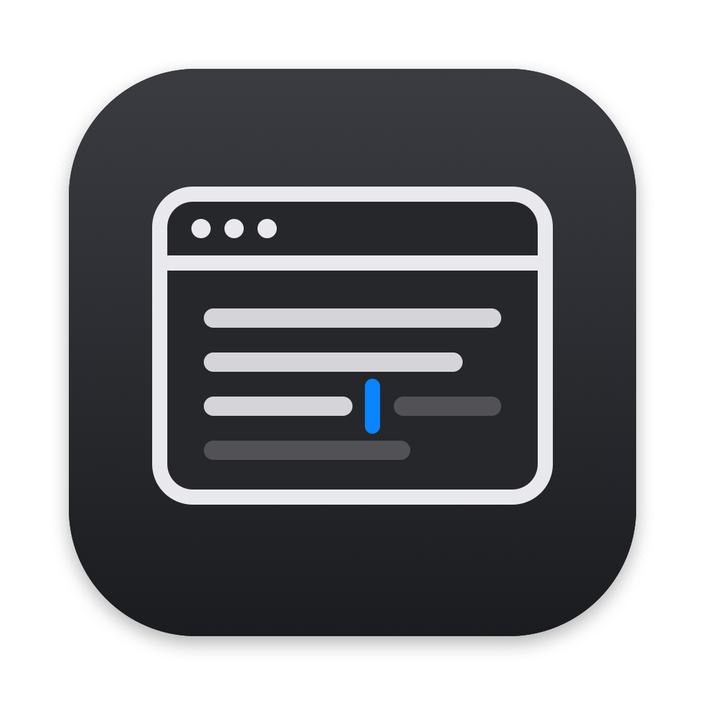

<p align="center"></p>

# AutoWriter

A Mac app that types a document into whatever window you point it at, such as
Google Docs, Google Search, Word, Pages, TextEdit or Notes. It types as real
keystrokes, exactly as written, so you don't have to type it yourself. It's a
companion to [Window Watcher](https://github.com/XmanXay69/window-watcher),
with the same look and the same build setup.

- Load a document by **dropping it** on the window, with **Open…**, or by
  **pasting** text: `.txt`, `.md`, `.docx` (also `.doc`, `.rtf`, `.odt`) and `.pdf`.
  You can edit the preview before typing; AutoWriter types exactly what it shows.
- Press **Start** (or **⌃⌥⌘T** from any app). During the 5-second countdown,
  click where the text should go. Then it types, from the first character to the last.
- A **speed slider** in words per minute (20–1,000 WPM; 200 to start).
- **Safety:** it only types into the window you picked. If that window loses
  focus (you click another app or switch tabs), it pauses by itself and tells you why,
  then picks up again a few seconds after you click back.
- **Progress bar**, characters typed and time left. If you stop, it remembers
  where it got to, even after quitting, and continues from there.
- **Check Result** copies what ended up in the window and compares it with your
  text, character by character, and explains any differences.

## Install

You need **Xcode** (free in the App Store; open it once so it finishes setting
up) and **XcodeGen**:

```bash
brew install xcodegen
```

Then build and install AutoWriter into Applications:

```bash
cd ~/Desktop/Coding/AutoWriter
scripts/build.sh --install
```

`--install` signs the app with your free "Apple Development" certificate (you
get one by signing into Xcode with your Apple ID). That gives every build the
same identity, so macOS remembers the permission below when you update. Without
the certificate it still works, but you'd turn the permission on again after each update.

Other build options:
- `scripts/build.sh` builds `dist/AutoWriter.app` without installing it.
- `scripts/build.sh --dmg` makes `dist/AutoWriter.dmg` to share. Other people
  get a "not notarized" warning the first time. They fix it in System Settings →
  Privacy & Security → Open Anyway.

## Turn on the permission (one time)

AutoWriter needs **Accessibility**, which lets it press keys in other apps and
see which window is in front. Only you can turn it on:

1. Open AutoWriter. It shows a setup screen.
2. Click **Open System Settings**. It opens Privacy & Security → Accessibility.
3. Turn on **AutoWriter**. (Not in the list? Click **+** and pick it in Applications.)
4. Go back to AutoWriter. The setup screen goes away by itself within a second.

Still seeing the setup screen with the switch on? macOS is remembering an older
copy of the app. Click **Reset Permission**, turn AutoWriter on again, then
**Quit & Reopen**.

It does **not** need Screen Recording, because it never looks at your screen; it
asks macOS for window names instead. It doesn't need Input Monitoring either. Its
shortcuts use the same no-permission "hot key" system as Window Watcher's ⌘⇧C.

## Using it

1. Load your text (drop, Open…, or Paste) and fix anything in the preview.
2. Pick the speed.
3. Choose where it types:
   - **Easiest:** don't lock anything. Press Start, then click into the spot
     where the text should go before the countdown ends.
   - **Or lock a window first:** the top card shows the last window you used;
     click **Lock This Window**, or **Choose Window…** to pick from a list. Start
     then brings that window to the front for you.
4. Hands off the keyboard and mouse while it types. AutoWriter's window stays
   on top so you can watch the progress (turn that off in the **Typing** menu).

| Shortcut | Works from any app |
|---|---|
| **⌃⌥⌘T** | Start (or resume) |
| **⌃⌥⌘P** | Pause / resume |
| **Esc** or **⌘⇧.** | Stop. It remembers the place, so Start continues from there |

Esc and ⌘⇧. only belong to AutoWriter while it's typing. The rest of the time
they work normally in your other apps.

Typing pauses by itself when:
- you click another app or another window of the same app,
- you switch to a different tab or document (it watches the window's title),
- your screen locks.

It continues 3 seconds after you're back, so you have time to click where it
should continue. Clicking inside the same window moves the text cursor, and
AutoWriter can't see the cursor, so click at the end of what it typed.

While you hold ⌘, ⌥, ⌃ or ⇧, typing waits, so a typed letter can never turn into a shortcut.

## Google Docs

Google Docs changes text as you type: `"` becomes `“ ”`, `i` becomes `I`, `1. `
starts a numbered list, `--` becomes `—`, web addresses become links. AutoWriter
always sends exactly your characters, so to make them land unchanged, turn these
off once (Google saves them to your account). In a Google Doc, open **Tools →
Preferences** and uncheck:

- Automatically capitalize words
- Use smart quotes
- Automatically detect links
- Automatically detect lists
- Automatically detect Markdown (if you see it)
- Show Smart Compose suggestions (a Tab in your text could accept a suggestion)
- On the **Substitutions** tab, if there is one: Automatic substitution and Spelling corrections

The same list is in the app under **Setup Tips…**. Afterwards, **Check Result**
shows anything that still came out different, grouped by cause ("Straight quotes
became curly quotes", "Letters were capitalized"…), with the setting that fixes it.

Also good to know:
- AutoWriter presses the real **Return** key for new lines and **Tab** for tabs.
  Emoji, accents and other alphabets are typed whole (😀, 👨‍👩‍👧‍👦, café, 日本語).
- Typing `@` at the start of a word opens Docs' insert menu. AutoWriter keeps
  typing, but check those spots afterwards.
- If Check Result finds missing letters, lower the speed.

## Google Search

Switch the mode to **Google Search**. It types your text as one line (new lines
and tabs become spaces) into whatever search box you click during the
countdown: google.com or the browser's address bar. Turn on **Press Return at
the end** to run the search. Google only uses the first 32 words of a search.

## TextEdit, Pages, Notes

Mac apps use macOS's own typing helpers. **Setup Tips…** shows which ones are on
right now. To turn them off: **System Settings → Keyboard → Text Input → Edit…**:
- Correct spelling automatically
- Capitalize words automatically
- Add period with double-space (turns two spaces into ". ")
- Use smart quotes and dashes

TextEdit also has its own switches under **Edit → Substitutions** and **Edit →
Spelling and Grammar**. Pages has them under **Pages → Settings → Auto-Correction**.

## Microsoft Word

Not tested yet. These Word settings change typed text. In **Word → Settings → AutoCorrect**:
- **AutoCorrect** tab: Capitalize first letter of sentences, Replace text as you type
- **AutoFormat As You Type** tab: "Straight quotes" with “smart quotes”, Hyphens
  (--) with dash (—), Internet and network paths with hyperlinks, Automatic
  bulleted lists, Automatic numbered lists

## How documents become text

- **.md (Markdown):** the symbols are removed, so `# Title` types as `Title`,
  `**bold**` as `bold` and `[a link](https://…)` as `a link`. List dashes and
  numbers stay, table rows become cells separated by tabs, and lines wrapped
  inside a paragraph are joined.
- **.docx:** read with the same macOS reader TextEdit uses. Bullets become `• `
  and numbered items `1. `.
- **.pdf:** PDFs break lines at the edge of the page, so AutoWriter joins them
  back into paragraphs using where each line sits on the page (spacing,
  indents, short last lines) and rejoins words split with a hyphen. Untick
  **Join PDF lines into paragraphs** to get the raw lines. Scanned PDFs
  (pictures of text) have no text to type, and AutoWriter tells you so.
- Invisible control characters (for example from old files) are removed,
  because some of them would act like Backspace or Esc if typed.

Not yet: keeping formatting like headings, bold and bullets as real formatting.

## For the curious: how it works

| File | What it does |
|---|---|
| `App/Core/Typist.swift` | The typing loop: steady speed, countdown, pause/resume, auto-pause, never skips or repeats a character |
| `App/Core/Keystrokes.swift` | Turns each character into a keyboard event with that exact text attached (Apple's CGEvent API) |
| `App/Core/Documents.swift` | Gets plain text out of .txt, .md, .docx and .pdf files |
| `App/Core/Compare.swift` | Check Result: compares the window's text with yours and names the cause of each difference |
| `App/Core/Targets.swift` | Which app a window belongs to, title matching, speed math |
| `App/Mac/Windows.swift` | Finds windows and checks which one is in front (Accessibility API) |
| `App/Mac/HotKeys.swift` | The shortcuts that work from any app (Carbon hot keys, like Window Watcher) |
| `App/Mac/Keyboard.swift` | Posts the keystrokes; saves and restores your clipboard during Check Result |
| `App/AppModel.swift` | Connects everything to the window |
| `App/UI/` | The window, in Window Watcher's style |

## Tests

```bash
scripts/test.sh
```

That runs the unit tests: the typing loop (including auto-pause and resume),
every kind of character, file loading and Check Result. They need no permissions.

```bash
scripts/selftest.sh textedit
```

That's a real-world test. AutoWriter opens a new TextEdit document, types a
tricky sample (emoji, quotes, tabs, accents, other alphabets), reads it back
and prints a report. `scripts/selftest.sh docs` does the same at the end of the
Google Doc that's open in your browser. `scripts/selftest.sh search` types a
search on google.com in Chrome. Add a speed, like `scripts/selftest.sh docs 600`.
Hands off the keyboard and mouse while it runs.

## License

MIT
